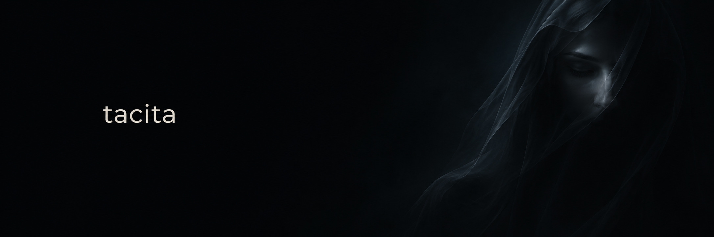

[](https://www.conventionalcommits.org/en/v1.0.0/)
[](https://doc.rust-lang.org/edition-guide/rust-2021/index.html)
[](LICENSE)

Tacita is an immediate mode GUI framework written in Rust.
The application declares controls each frame.
Tacita retains interaction state between frames.

The application owns its window, graphics device, and swap chain.
Tacita produces draw data for a renderer.
The core uses `no_std` with `alloc`.

## Features

- The core provides windows, tabs, menus, popups, scroll areas, and docking.
- The layout system supports rows, columns, grids, wrapping, and spanning.
- Data controls include virtualized lists, sortable tables, plots, curve editors, and gradient editors.
- The text system supports shaping, bidirectional layout, font fallback, and multiline editing.
- The input system supports keyboard navigation, shortcuts, mouse capture, and drag operations.
- The animation system provides tweens, springs, keyframes, and reduced motion settings.
- Renderers support rounded shapes, gradients, masks, blur, and rendering into textures.
- The core exposes accessibility nodes for the application.
- The Windows accessibility bridge uses Microsoft Active Accessibility.

## Build and run

The Windows build requires Rust, Microsoft C++ build tools, and the Windows SDK.
Cargo package names retain the `restricted-gui` prefix.
These commands run from the repository root.

Cargo starts the wgpu demo:

```sh
cargo run --locked -p restricted-gui-demo
```

Cargo starts the D3D11 example:

```sh
cargo run --locked -p restricted-gui-d3d11 --example overlay_d3d11
```

Cargo starts the D3D12 example:

```sh
cargo run --locked -p restricted-gui-d3d12 --example overlay_d3d12
```

## Rust integration

The SDK provides control functions through `Gui`.
The application creates `Gui` once with font bytes.

This function declares controls inside an active frame:

```rust
use restricted_gui_sdk::{Gui, ScrollFlags};

fn settings(gui: &mut Gui, enabled: &mut bool) {
    gui.begin_window("Settings", ScrollFlags::NONE);
    gui.checkbox("Enabled", enabled);
    gui.end_window();
}
```

The application follows this sequence each frame:

1. The application calls `Gui::new_frame(input, dt)`.
2. The application declares controls through the SDK.
3. The application checks `Gui::atlas_generation()` after declaring controls.
4. The application uploads `Gui::atlas_pixels()` before its first draw and whenever the atlas generation changes.
5. The application calls `Gui::render()` to obtain `DrawData`.
6. The renderer consumes `DrawData` before the application starts the next frame.

The `dt` argument measures elapsed time in seconds.
The application uses logical pixels for input and layout.
The renderer applies the display scale.

The application closes each `begin_*` call with its matching `end_*` call.
The SDK panics when the application leaves a scope open.

The [D3D11 example](backends/d3d11/examples/overlay_d3d11.rs) shows input handling and renderer integration.
The [D3D12 example](backends/d3d12/examples/overlay_d3d12.rs) shows the equivalent D3D12 integration.

## C and C++ integration

The [C header](ffi/restricted_gui.h) defines the C interface.
The C wrapper exposes context handles, control functions, and draw data.
The C wrapper catches Rust panics at the C boundary.
The application reads errors through `gui_last_error_code()`.

Cargo builds the static library and dynamic library:

```sh
cargo build --locked -p restricted-gui-ffi
```

The [C++ smoke program](ffi/tests/smoke.cpp) shows context creation, control declarations, and draw data access.

## Workspace

| Path | Responsibility |
| --- | --- |
| [`core`](core) | Implements controls, layout, input, text, and drawing. |
| [`sdk`](sdk) | Exposes control functions through `Gui`. |
| [`ffi`](ffi) | Exposes the C interface. |
| [`backends/d3d11`](backends/d3d11) | Renders draw data through D3D11. |
| [`backends/d3d12`](backends/d3d12) | Renders draw data through D3D12. |
| [`backends/shaders`](backends/shaders) | Defines shared HLSL and WGSL shaders. |
| [`adapters/win32`](adapters/win32) | Translates Win32 messages into input. |
| [`host`](host) | Provides clipboard, accessibility, and file watching services. |
| [`demo`](demo) | Runs the wgpu demo. |
| [`fuzz`](fuzz) | Tests parsers and input with generated data. |
| [`rhai-probe`](rhai-probe) | Tests Rhai integration separately. |

The `fuzz` and `rhai-probe` directories contain separate Cargo workspaces.

## Checks

These commands run the workspace checks on Windows:

```sh
cargo test --locked --workspace
cargo clippy --locked --workspace --all-targets -- -D warnings
```

The native renderer tests draw into offscreen textures.
The [D3D11 image tests](backends/d3d11/tests/visual_regression.rs) compare captures at four display scales.
The [allocation tests](core/tests/zero_alloc.rs) check selected frame sequences after warmup.

The bare-metal build checks the `no_std` core and SDK:

```sh
rustup target add x86_64-unknown-none
cargo build --locked -p restricted-gui -p restricted-gui-sdk --target x86_64-unknown-none
```

Git Bash runs the C++ smoke check:

```sh
bash ffi/tests/build_smoke.sh
```

## Scope

The core requires an allocator.
Initialization, new glyphs, and storage growth can allocate memory.
Allocation tests cover specific frame sequences after warmup.

The native renderers require Windows.
The demo contains the wgpu renderer.
The SVG parser supports a limited set of monochrome shapes.

The docking system supports left, right, and floating panels.
The Windows accessibility bridge does not expose UI Automation text patterns.

Bundled fonts retain their license notices in [`core/tests/assets`](core/tests/assets).
